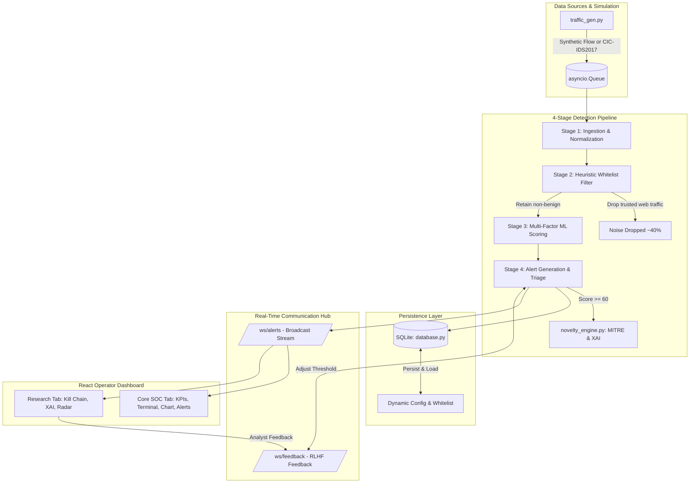

# 🛡️ CSOC — Cognitive Security Operations Center
### Enterprise-Grade Cyber Threat Detection & Explainable AI (XAI) Triage Platform

[](https://python.org)
[](https://fastapi.tiangolo.com)
[](https://react.dev)
[](https://attack.mitre.org)
[](https://sqlite.org)

---

## 📌 Executive Summary

**CSOC (Cognitive Security Operations Center)** is an academic Project-Based Learning (PBL) prototype of a next-generation **SIEM / SOAR platform**. It bridges the gap between raw, overwhelming network telemetry and actionable cyber incident containment by combining:

1. **A 4-Stage High-Throughput Detection Pipeline** (Ingest $\rightarrow$ Heuristic Noise Drop $\rightarrow$ Multi-Factor ML Anomaly Scoring $\rightarrow$ Alert Triage).
2. **Explainable AI (XAI) & MITRE ATT&CK® Mapping** translating numerical anomaly scores into plain-English incident narratives and step-by-step containment playbooks.
3. **Human-in-the-Loop (RLHF) Dynamic Tuning** allowing Tier-1/Tier-2 SOC analysts to confirm threats or mark benign false positives over WebSockets, adjusting alerting thresholds in real-time.
4. **Interactive Cyberpunk Operations Dashboard** featuring DEFCON level alerts, real-time threat score area curves, interactive React Flow attack kill chains, and an organizational **Blind Spot Index**.

---

## 🏗️ System Architecture & Data Flow



---

## 🧠 The 4-Stage Detection Pipeline

| Stage | Name | Algorithm / Heuristic Logic | Real-World SOC Equivalent |
|---|---|---|---|
| **Stage 1** | **Ingest** | Deserializes raw `NetworkLog` flows, enriches with ingestion timestamps, and tracks global throughput. | Logstash / Fluentd / Kafka Ingestion Broker |
| **Stage 2** | **Heuristic Drop** | Identifies and drops internal-to-internal web flows (`10.0.x.x`, `192.168.1.x` on ports 80/443 labeled normal), reducing telemetry volume by ~40%. | Perimeter Firewall Pre-filters & SIEM Ingestion Whitelisting |
| **Stage 3** | **ML Anomaly Scoring** | Computes composite risk score ($0-100$) factoring in payload volume, port risk profile, unusual protocols, source frequency, packet count spikes, and TTL spoofing indicators. | Statistical Anomaly Engine / UEBA (User & Entity Behavior Analytics) |
| **Stage 4** | **Alert Generation** | Classifies flows (`CRITICAL ≥85`, `HIGH ≥60`, `MEDIUM ≥35`, `LOW <35`). Filters against analyst whitelists. Enriches HIGH/CRITICAL events with XAI. | SOAR Incident Creation & Triage Engine |

---

## 🎯 MITRE ATT&CK® & Explainable AI (XAI) Matrix

Every alert elevated to `HIGH` or `CRITICAL` is dynamically mapped to the **MITRE ATT&CK Framework**:

| Attack Vector | MITRE Technique ID | Technique Name | Tactic | Generated Playbook Highlights |
|---|---|---|---|---|
| **DDoS Attack** | `T1498` | Network Denial of Service | Impact | Rate-limit inbound SYN packets at perimeter firewall; initiate upstream BGP blackholing. |
| **Port Scan** | `T1046` | Network Service Discovery | Discovery | Apply 24h temporary ACL block on source IP; audit exposed perimeter ports. |
| **Data Exfiltration** | `T1041` | Exfiltration Over C2 Channel | Exfiltration | Immediate network isolation (quarantine VLAN); egress proxy block; initiate IR Playbook PR-04. |
| **Brute Force** | `T1110` | Brute Force Credentials | Credential Access | Auto-lock target account; enforce MFA on SSH/RDP; rotate session credentials. |
| **Suspicious Activity** | `T1071` | Application Layer Protocol Abuse | Command & Control | Flag source IP for 48h enhanced watchlist; inspect TLS SNI/JA3 fingerprints. |

---

## 💻 Tech Stack & Requirements

### Backend
* **Python**: $\ge 3.11$ (Tested on Python 3.13)
* **Framework**: FastAPI (Async ASGI, Lifespan architecture)
* **Server**: Uvicorn
* **ORM & Database**: SQLAlchemy 2.0+ with SQLite (`soc_prototype.db`)
* **Real-Time Protocol**: WebSockets (`websockets`)

### Frontend
* **Runtime**: Node.js $\ge 18$
* **Framework**: React 18 + Vite 5
* **Styling**: Tailwind CSS + Custom Cyberpunk Glow & Scanline Engine
* **Visualizations**:
  * **Recharts**: Responsive real-time area threat timeline
  * **@xyflow/react (React Flow)**: Interactive directed cyber kill-chain graph
  * **Lucide Icons**: Cyberpunk HUD iconography

---

## 🚀 Quick Start Guide

### Step 1: Clone Repository
```bash
git clone https://github.com/SOHAM-MOKASHI/PBL.git
cd PBL
```

### Step 2: Backend Setup
```bash
cd backend
pip install -r requirements.txt
uvicorn main:app --host 0.0.0.0 --port 8000 --reload
```
* Backend API Documentation: `http://localhost:8000/docs`
* Health Check: `http://localhost:8000/health`

### Step 3: Frontend Setup (Separate Terminal)
```bash
cd frontend
npm install
npm run dev
```
* Operator Dashboard: `http://localhost:5173`

---

## 📡 REST API & WebSocket Reference

| Method | Route | Description |
|---|---|---|
| `GET` | `/health` | Liveness and health check endpoint. |
| `GET` | `/api/metrics` | Ingested, dropped, scored, and alert counters. |
| `GET` | `/api/logs/recent` | Retrieves rolling sliding window of processed logs. |
| `GET` | `/api/alerts` | Fetches active prioritized security incidents. |
| `GET` | `/api/timeline` | Returns 1-second bucketing timeline data for threat charting. |
| `GET` | `/api/telemetry` | Telemetry coverage analysis and Blind Spot Index ($0.0-1.0$). |
| `GET` | `/api/threshold` | Current alert threshold and active benign IP whitelist. |
| `WS` | `/ws/alerts` | Bidirectional real-time stream for telemetry, logs, and alerts. |
| `WS` | `/ws/feedback` | Real-time RLHF feedback channel for analyst threshold tuning. |

---

## 🧪 Running the Backend Verification Test Suite

A comprehensive test suite covering all REST endpoints, WebSocket connections, pipeline throughput, XAI enrichment, and threshold logic is included:

```bash
cd backend
python test_csoc.py
```

---

## 🧑‍🏫 Live Presentation & Mentor Defense Guide

During your review with your **Industrial Mentor**, follow this **3-Minute High-Impact Demo Sequence**:

1. **Authentication (0:00 - 0:30):**
   - Open `http://localhost:5173`.
   - Enter credentials (`admin` / `password`) and click **"Initiate Handshake"**.
   - Explain: *"Our platform enforces strict operator clearance and logs every authentication handshake."*
2. **Core SOC Situational Awareness (0:30 - 1:30):**
   - Point out the **DEFCON status** and the **4-Stage Pipeline View**.
   - Explain: *"Our Stage 2 filter drops internal web traffic, instantly reducing raw noise by over 40% so analysts only focus on anomalies."*
   - Observe the **Threat Score Timeline** reacting in real time as attack bursts inject.
3. **Deep-Dive Triage & XAI (1:30 - 2:30):**
   - In the **Alert Panel**, click **"Inspect"** on an active `CRITICAL` alert.
   - The UI automatically switches to the **AI Research Modules** tab.
   - Walk through the **Kill Chain Graph**: *"Here, React Flow dynamically maps the adversary from source IP through each tactic directly to our target host."*
   - Point to the **AI Narrative** and **MITRE Technique ID**: *"Rather than guessing, Tier-1 analysts get an immediate, plain-English summary and an incident containment playbook."*
4. **Analyst RLHF & Incident Escalation (2:30 - 3:00):**
   - Click **"Confirm Threat"** or **"Mark Benign"**: *"Notice the Dynamic Threshold HUD instantly adjusts over WebSockets and saves to SQLite."*
   - Click **"Escalate to Admin & Download Report"**: Show the generated incident report downloaded to your machine.
