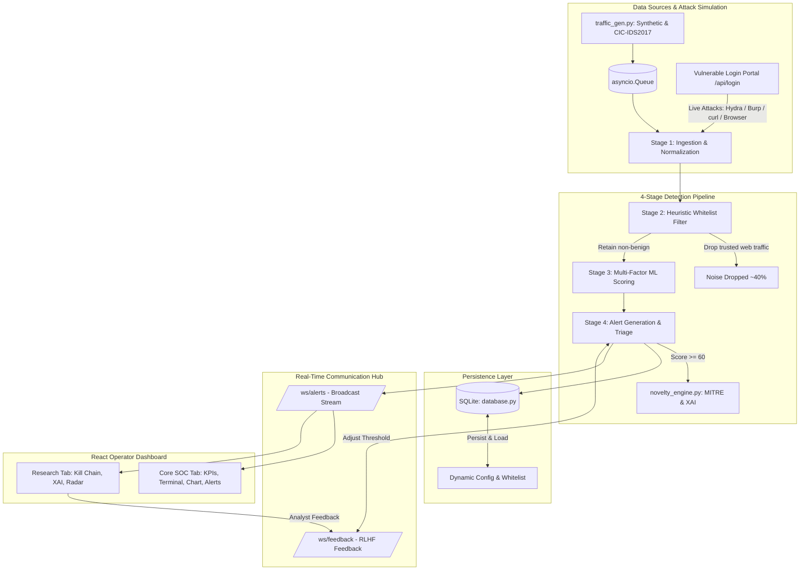

# 🛡️ CSOC — Cognitive Security Operations Center
###  Cyber Threat Detection & Explainable AI (XAI) Triage Platform

[](https://python.org)
[](https://fastapi.tiangolo.com)
[](https://react.dev)
[](https://attack.mitre.org)
[](https://sqlite.org)

---

## 📌 Executive Summary

**CSOC (Cognitive Security Operations Center)** is an academic Project-Based Learning (PBL) prototype of a next-generation **SIEM / SOAR platform**. It bridges the gap between raw, overwhelming network telemetry and actionable cyber incident containment by combining:

1. **A 4-Stage High-Throughput Detection Pipeline** (Ingest $\rightarrow$ Heuristic Noise Drop $\rightarrow$ Multi-Factor ML Anomaly Scoring $\rightarrow$ Alert Triage).
2. **Explainable AI (XAI) & MITRE ATT&CK® Mapping** translating numerical anomaly scores into plain-English incident narratives and step-by-step containment playbooks.
3. **Human-in-the-Loop (RLHF) Dynamic Tuning** allowing Tier-1/Tier-2 SOC analysts to confirm threats or mark benign false positives over WebSockets, adjusting alerting thresholds in real-time.
4. **Interactive Security Operations Dashboard** featuring real-time threat status, threat velocity curves, and an organizational **Blind Spot Index**.

---

## 🏗️ System Architecture & Data Flow



---

## 🧠 The 4-Stage Detection Pipeline

| Stage | Name | Algorithm / Heuristic Logic | Real-World SOC Equivalent |
|---|---|---|---|
| **Stage 1** | **Ingest** | Deserializes raw `NetworkLog` flows, enriches with ingestion timestamps, and tracks global throughput. | Logstash / Fluentd / Kafka Ingestion Broker |
| **Stage 2** | **Heuristic Drop** | Identifies and drops internal-to-internal web flows (`10.0.x.x`, `192.168.1.x` on ports 80/443 labeled normal), reducing telemetry volume by ~40%. | Perimeter Firewall Pre-filters & SIEM Ingestion Whitelisting |
| **Stage 3** | **ML Anomaly Scoring** | Computes composite risk score ($0-100$) factoring in payload volume, port risk profile, unusual protocols, source frequency, packet count spikes, and TTL spoofing indicators. | Statistical Anomaly Engine / UEBA (User & Entity Behavior Analytics) |
| **Stage 4** | **Alert Generation** | Classifies flows (`CRITICAL ≥85`, `HIGH ≥60`, `MEDIUM ≥35`, `LOW <35`). Filters against analyst whitelists. Enriches HIGH/CRITICAL events with XAI. | SOAR Incident Creation & Triage Engine |

---

## 🎯 MITRE ATT&CK® & Explainable AI (XAI) Matrix

Every alert elevated to `HIGH` or `CRITICAL` is dynamically mapped to the **MITRE ATT&CK Framework**:

| Attack Vector | MITRE Technique ID | Technique Name | Tactic | Generated Playbook Highlights |
|---|---|---|---|---|
| **DDoS Attack** | `T1498` | Network Denial of Service | Impact | Rate-limit inbound SYN packets at perimeter firewall; initiate upstream BGP blackholing. |
| **Port Scan** | `T1046` | Network Service Discovery | Discovery | Apply 24h temporary ACL block on source IP; audit exposed perimeter ports. |
| **Data Exfiltration** | `T1041` | Exfiltration Over C2 Channel | Exfiltration | Immediate network isolation (quarantine VLAN); egress proxy block; initiate IR Playbook PR-04. |
| **Brute Force** | `T1110` / `T1110.001` | Brute Force: Password Guessing | Credential Access | Auto-lock target account; enforce MFA on SSH/RDP/HTTP; rotate session credentials. |
| **SQL Injection** | `T1190` | Exploit Public-Facing Application | Initial Access | Block offending source IP; review WAF logs; audit input sanitization & parameterised queries. |
| **XSS Attack** | `T1059.007` | Command & Scripting Interpreter: JavaScript | Execution | Sanitise user inputs; enforce Content-Security-Policy headers; inspect session cookies. |
| **Suspicious Activity** | `T1071` | Application Layer Protocol Abuse | Command & Control | Flag source IP for 48h enhanced watchlist; inspect TLS SNI/JA3 fingerprints. |

---

## 💻 Tech Stack & Requirements

### Backend
* **Python**: $\ge 3.11$ (Tested on Python 3.13)
* **Framework**: FastAPI (Async ASGI, Lifespan architecture)
* **Server**: Uvicorn
* **ORM & Database**: SQLAlchemy 2.0+ with SQLite (`soc_prototype.db`)
* **Real-Time Protocol**: WebSockets (`websockets`)

### Frontend
* **Runtime**: Node.js $\ge 18$
* **Framework**: React 18 + Vite 5
* **Styling**: Tailwind CSS
* **Visualizations**:
  * **Recharts**: Responsive real-time area threat timeline
  * **Lucide Icons**: Professional clean UI iconography

---

## 🚀 Quick Start Guide

### Step 1: Clone Repository
```bash
git clone https://github.com/SOHAM-MOKASHI/PBL.git
cd PBL
```

### Step 2: Backend Setup
```bash
cd backend
pip install -r requirements.txt
uvicorn main:app --host 0.0.0.0 --port 8000 --reload
```
* Backend API Documentation: `http://localhost:8000/docs`
* Health Check: `http://localhost:8000/health`

### Step 3: Frontend Setup (Separate Terminal)
```bash
cd frontend
npm install
npm run dev
```
* Operator Dashboard: `http://localhost:5173`

### Step 4: Access the Live Vulnerable Login Target
Once the backend is running, the simulated authentication gateway is automatically online:
* **Target Portal (Browser)**: `http://localhost:8000/vulnerable-login` (or `http://localhost:8000/login`)
* **API Ingestion Route**: `http://localhost:8000/api/login`
* **Default Authorized Credentials**: `admin` / `admin123`

---

## 🎯 Vulnerable Login Target & Live Attack Testing

To demonstrate that the CSOC pipeline detects and triages real, live cyberattacks (beyond pre-generated dataset replay), a standalone **University Authentication Gateway** is embedded directly into the backend service.

Any inbound authentication attempt—whether originating from a browser, a custom Python script, `curl`, or penetration testing utilities like **Hydra** or **Burp Suite**—is captured in real time, transformed into a standard `NetworkLog`, and processed through the detection pipeline.

### 🌐 Accessing the Target
| Interface | URL | Purpose |
|---|---|---|
| **Web Browser Portal** | `http://localhost:8000/vulnerable-login` | Interactive web UI for manual testing & demo |
| **API Ingestion Endpoint** | `http://localhost:8000/api/login` | Direct target for automated attack scripts & CLI tools |
| **Alternative Aliases** | `http://localhost:8000/login`, `/portal` | Route aliases for external fuzzers / scanners |

* **Valid Test Credentials**: Username: `admin` | Password: `admin123`
* Any incorrect attempt or malicious string is logged as an attack and passed to the CSOC.

---

### ⚔️ Executing Live Attack Scenarios

#### Scenario 1: Credential Brute Force (`T1110.001`)
Simulate rapid password guessing or credential stuffing:

**Using Bash / Git Bash / curl:**
```bash
for i in {1..10}; do
  curl -s -X POST http://localhost:8000/api/login \
    -H "Content-Type: application/json" \
    -d "{\"username\": \"admin\", \"password\": \"wrongpass$i\"}"
  echo " Attempt $i sent"
done
```

**Using Windows PowerShell:**
```powershell
1..10 | ForEach-Object {
    Invoke-RestMethod -Uri "http://localhost:8000/api/login" -Method Post -ContentType "application/json" -Body "{`"username`":`"admin`",`"password`":`"wrongpass$_`"}"
}
```

#### Scenario 2: SQL Injection Attempt (`T1190`)
Simulate an authentication bypass exploit payload:
```bash
curl -X POST http://localhost:8000/api/login \
  -H "Content-Type: application/json" \
  -d '{"username": "admin'\'' OR '\''1'\''='\''1", "password": "nopass"}'
```

#### Scenario 3: Cross-Site Scripting (XSS) Vector (`T1059.007`)
Inject client-side script payloads into the authentication field:
```bash
curl -X POST http://localhost:8000/api/login \
  -H "Content-Type: application/json" \
  -d '{"username": "<script>alert(document.cookie)</script>", "password": "test"}'
```

#### Scenario 4: External Security Tools (Hydra / Burp Suite)
Target the API or form endpoint with Hydra:
```bash
# Hydra HTTP-POST form brute-force example
hydra -l admin -P /path/to/wordlist.txt localhost -s 8000 http-post-form "/vulnerable-login:username=^USER^&password=^PASS^:Invalid credentials"
```

---

### 🔄 End-to-End Attack Lifecycle & Data Flow
When an attack is launched against the vulnerable login page:
1. **Metadata Capture (`backend/main.py`)**: The `_handle_login_attempt` handler inspects the incoming payload for injection signatures, tracks attempt frequency per client IP in a 60-second sliding window, and builds a `NetworkLog` object.
2. **Database Persistence (`backend/database.py`)**: The event is immediately inserted into SQLite (`soc_prototype.db`) under the `network_logs` table.
3. **Pipeline Evaluation**:
   - **Stage 2**: Evaluates destination port (8000) and flags external attack traffic.
   - **Stage 3**: The Isolation Forest anomaly scorer flags anomalous frequency/payload patterns, elevating the threat score ($0-100$).
   - **Stage 4**: If threat score $\ge 60$ (or configured threshold), a security alert is created and enriched with MITRE tactic and XAI narrative.
4. **WebSocket Stream (`/ws/alerts`)**: Broadcasts the alert in real time to the React dashboard (`http://localhost:5173`).
5. **Dashboard Reflection**:
   - The **Terminal Feed** logs the incoming HTTP event.
   - The **Threat Score Timeline** spikes in real time.
   - The **Alert Panel** displays a new prioritized alert with an incident investigation playbook.

---

## 📡 REST API & WebSocket Reference

| Method | Route | Description |
|---|---|---|
| `GET` | `/health` | Liveness and health check endpoint. |
| `GET` | `/api/metrics` | Ingested, dropped, scored, and alert counters. |
| `GET` | `/api/logs/recent` | Retrieves rolling sliding window of processed logs. |
| `GET` | `/api/alerts` | Fetches active prioritized security incidents. |
| `GET` | `/api/timeline` | Returns 1-second bucketing timeline data for threat charting. |
| `GET` | `/api/telemetry` | Telemetry coverage analysis and Blind Spot Index ($0.0-1.0$). |
| `GET` | `/api/threshold` | Current alert threshold and active benign IP whitelist. |
| `POST` | `/api/config/threshold` | Updates and persists the anomaly sensitivity threshold to SQLite. |
| `GET` | `/login` / `/vulnerable-login` | Web authentication portal target for live cyberattack testing. |
| `POST` | `/api/login` | Ingestion endpoint for simulated attacks (Brute Force, SQLi, XSS). |
| `WS` | `/ws/alerts` | Bidirectional real-time stream for telemetry, logs, and alerts. |
| `WS` | `/ws/feedback` | Real-time RLHF feedback channel for analyst threshold tuning. |

---

## 🧪 Running the Backend Verification Test Suite

A comprehensive test suite covering all REST endpoints, WebSocket connections, pipeline throughput, XAI enrichment, and threshold logic is included:

```bash
cd backend
python test_csoc.py
```
